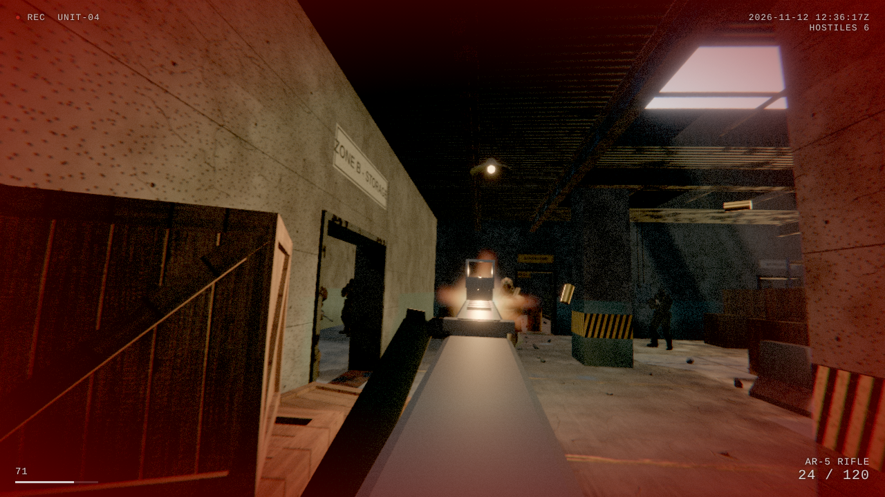

# BODYCAM // Facility 7

A single-player, browser-based first-person shooter built around a body-mounted camera look.
Three.js + TypeScript + Vite + Rapier. Everything runs client-side; there is no backend.



## Play

Click to deploy, then eliminate all six hostiles in the facility.

| Action | Input |
| --- | --- |
| Move | W A S D |
| Look | Mouse |
| Sprint | Left Shift |
| Crouch | C (toggle) / Left Ctrl (hold) |
| Fire | Left mouse |
| Aim | Right mouse (hold) |
| Reload | R |
| Rifle / Pistol | 1 / 2 (Q or wheel toggles) |

## Develop

```bash
npm install
npm run dev            # http://localhost:5173
npm run build          # type-check + production build into dist/
npm run preview        # serve dist/ on :4173
npm run test:e2e       # 40-check gameplay test (needs `npm run preview` running and Chrome)
npm run bake:textures  # regenerate the procedural PBR texture sets
```

Screenshots from the real game: `node scripts/shot.mjs '<json>' http://localhost:4173/` (see the script header).

## Deploy (Vercel)

Static site. `vercel.json` sets the build command (`npm run build`) and output directory (`dist`).
Import the repository in Vercel, or run `vercel --prod`. Asset paths are relative (`base: './'`), so the
build also works from a sub-path.

## Documentation

- [PROJECT_GUIDE.md](PROJECT_GUIDE.md) – conventions and key decisions
- [docs/ARCHITECTURE.md](docs/ARCHITECTURE.md)
- [docs/CONTROLS.md](docs/CONTROLS.md)
- [docs/ASSET_CREDITS.md](docs/ASSET_CREDITS.md)
- [docs/TEST_PLAN.md](docs/TEST_PLAN.md) – what was tested, and what was not
